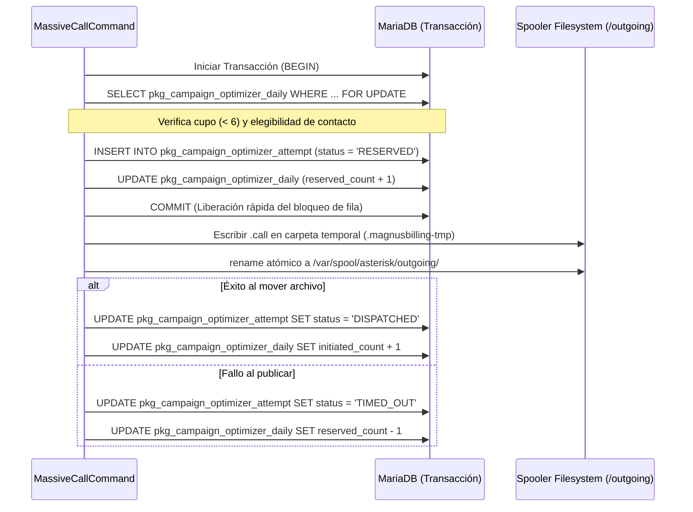

# Plan Maestro de Arquitectura y Especificación Técnica
# Módulo: Optimizador y Automatización de Campañas (`CampaignOptimizer`)
### MagnusBilling 8 (Fork Josuearv) — Asterisk 20 PJSIP / Yii 1.1 / ExtJS 6

---

## 1. Identidad, Contexto y Objetivos del Proyecto

* **Repositorio**: `https://github.com/Josuearv/magnusbilling8`
* **Rama de Trabajo**: `development`
* **Módulo Oficial**: `CampaignOptimizer` (Automatización y Optimización de Campañas Masivas)
* **Ubicación en Sistema**: Menú Principal -> *Marcación Masiva* (Módulo padre `id_module = 13`)
* **Propósito**: Sustituir de manera integral, robusta y nativa el conjunto de scripts fragmentados en Bash y Python ubicados históricamente en `/opt/` (`clean_campaing.py`, `cambiar_audio.sh`, `campaing_*.sh`, `Max_Call_*.sh`). El nuevo módulo proporciona control anti-quemado, gestión de cupos compartidos por destinatario, analítica forense de llamadas fallidas pre/post AGI, variación determinista de horarios (jitter anti-patrones), rotación atómica y versionada de audios, y coordinación transaccional con el motor de llamadas masivas (`MassiveCallCommand`).

---

## 2. Diagnóstico Forense de los Scripts Anteriores

La auditoría técnica realizada sobre los archivos del servidor y la base de código de MagnusBilling 8 reveló vulnerabilidades críticas y fallos estructurales que justifican la sustitución por una arquitectura desacoplada:

| Componente | Qué sucede en producción | Corrección e Implementación en el Nuevo Módulo |
| :--- | :--- | :--- |
| **Invocación con `/bin/sh`** | En Debian/Ubuntu, `/bin/sh` enlaza a `dash`. La sintaxis Bash `[[ ... ]]` y variables como `$RANDOM` fallan o provocan interpretaciones erróneas. | Sustitución completa por comandos CLI nativos en PHP/Yii (`CampaignOptimizerCommand.php`). |
| **Comparación `[[ $tmp > 9 ]]`** | En Bash realiza comparación lexicográfica (cadenas), no numérica. En `dash`, `> 9` se interpreta como redirección de salida al archivo `/root/9`. | Cálculo riguroso de fechas y horas mediante objetos `DateTimeImmutable` de PHP con validación de rangos. |
| **Archivo residual `/root/9`** | La existencia de `/root/9` (0 bytes, fechado a la 01:00) en el servidor confirmó la ejecución bajo `dash` y la creación accidental por redirección. | Erradicación total de scripts de shell para lógica de negocio. Registro centralizado en tabla de logs. |
| **Selección `RANDOM%17`** | Genera enteros del `0` al `16`. Nunca utiliza `audio17` e intenta acceder a `audio0` (inexistente en el disco). | Descubrimiento dinámico de carpetas y archivos válidos existentes en disco, validando permisos y formatos. |
| **Rotación con `rsync`** | Copia ciega de archivos. Si ocurre un fallo de lectura o permisos, no se captura el error y se oculta tras el `ls` posterior. | Procedimiento en dos fases: preparación en directorio controlado, verificación de integridad (checksum SHA-256) y sustitución atómica. |
| **Selección `where name='$name'`** | `select name from pkg_campaign where status='1'` concatena nombres si hay >1 campaña activa, rompiendo la consulta SQL en MariaDB. | Iteración segura mediante ActiveRecord y PDO vinculando por `id` entero parametrizado (`:id_campaign`). |
| **Recorte a 7 dígitos `[-7:]`** | Destruye la identidad del número nacional/internacional (`809XXXXXXX` vs `XXXXXXX`), impidiendo coincidencias en `pkg_phonenumber`. | Normalización canónica del número preservando tanto el formato de marcado original como el valor canónico para control de cupos. |
| **Conteo ciego por columna `src`** | En Asterisk CDR, `src` representa el Caller ID u origen. Contar por `src` evaluaba la troncal o el Caller ID rotativo en lugar del destinatario. | Trazabilidad por entidad de intento explícita (`attempt_id`) vinculada al destino real de la llamada. |
| **Desactivación global de teléfonos** | Ejecutar `UPDATE pkg_phonenumber SET status = 0` desactiva el número para **todas las campañas** del sistema que compartan la agenda. | Aislamiento de la política de campaña: el estado operativo de la agenda no se altera; la exclusión se persiste en `pkg_campaign_optimizer_state`. |
| **Bloque 4 de `clean_campaing.py`** | `WHERE status NOT IN (0, 4)` reactiva indiscriminadamente estados reservados y resultados terminales legítimos al vaciarse la agenda. | Eliminación de reactivaciones masivas automáticas. Generación de avisos de agenda agotada para gestión administrativa. |
| **Bloque 5 de `clean_campaing.py`** | Reactiva números si >40% de activos están restringidos, deshaciendo inmediatamente los bloqueos por fallas del Bloque 3. | El umbral del 40% se transforma en un indicador de alerta visual y de monitoreo; nunca en una reactivación automática descontrolada. |
| **Comparación de restricciones** | Compara solo por igualdad exacta (`WHERE number IN (...)`), ignorando usuario, dirección y matching por prefijos de `pkg_restrict_phone`. | Evaluación estricta de las reglas del motor de restricciones (`RestrictedPhonenumber`) considerando usuario, dirección y longitud de prefijo. |
| **Concurrencia sin coordinación** | `clean_campaing.py` ejecutaba updates masivos mientras `MassiveCall` leía y generaba archivos `.call` concurrentemente. | Coordinación mediante reservas con bloqueo pesimista de fila (`FOR UPDATE`), transacciones cortas y exclusión mutua local con `flock`. |
| **Conteo diario sin fecha límite** | `WHERE calldate >= %s` incluye días posteriores si se utiliza fecha manual o se cruza la medianoche durante el análisis. | Intervalos semiabiertos cerrados `[inicio_dia, fin_dia)` basados en la zona horaria de la campaña. |
| **Riesgo 02:00 (Backup vs Reboot)** | El crontab tenía programado a la misma hora `Backup` (mysqldump) y `/sbin/reboot`, amenazando con corromper el volcado de base de datos. | Desacoplamiento operativo de tareas de mantenimiento nocturno y revisión de necesidad de reboots diarios. |

> [!NOTE]
> **Aclaraciones Técnicas Objetivas**:
> 1. Fallar al copiar `audio0` no borra el audio existente porque el `rsync` configurado no usaba `--delete`.
> 2. Una cláusula `IN (...)` con miles de valores no revienta obligatoriamente a los 20.000 registros; depende de `max_allowed_packet` y de la memoria asignada en PHP/MariaDB, pero constituye una práctica de alto riesgo que debe erradicarse.
> 3. El archivo `/root/passwordMysql.log` posee permisos `600` (solo root); el riesgo real no era lectura no autorizada por terceros, sino la exposición de la contraseña administrativa en la línea de comandos en la tabla de procesos (`ps aux`).

---

## 3. Reglas de Negocio y Gobernanza Funcional

1. **Activación Progresiva (Modo Observación por Defecto)**:
   * Al instalarse, el módulo arranca en modo `OBSERVATION`. Monitorea, audita y calcula métricas sin alterar el despacho de llamadas.
   * Cada campaña debe ser incorporada explícitamente al modo `ACTIVE` por el administrador.
2. **Límite Diario Compartido (Anti-Quemado de Contactos)**:
   * Máximo configurable de **6 intentos autorizados por día local** por combinación de destinatario y propietario (`id_user` de la campaña).
   * Si un cliente posee 3 campañas distintas apuntando a la misma base de contactos, el límite de 6 llamadas se comparte entre ellas para evitar denuncias por acoso o spam telefónico.
3. **Consumo de Cupo (Reserva vs. Intento Iniciado)**:
   * **Reserva**: Cuando el optimizador pre-autoriza un número para despacho, reserva provisionalmente 1 cupo diario.
   * **Consumo Definitivo**: Se consolida una vez que el archivo `.call` ha sido generado y publicado en el spooler.
   * **Liberación**: Si ocurre un error antes de la publicación, la reserva se libera de inmediato.
4. **Suspensión Temporal por Fallos Recurrentes**:
   * Si un destinatario acumula **5 resultados terminales elegibles** (`NO ANSWER`, `BUSY`, `FAILED`) durante el día local, entra en suspensión temporal hasta las `23:59:59` de la zona horaria de la campaña.
   * Al día siguiente, la suspensión caduca automáticamente sin intervención manual.
5. **Aislamiento de Fallas de Infraestructura**:
   * Caídas de troncal, congestión de red interna de Asterisk (`CONGESTION` por saturación del proveedor) o códigos SIP 503 por indisponibilidad de servidor **no se imputan al destinatario** como falla de contacto.
6. **Restricción Permanente Exclusivamente Administrativa**:
   * El sistema automático nunca agregará registros a `pkg_restrict_phone` sin intervención humana. Los bloqueos permanentes requieren acción explícita y auditada desde la interfaz web.
7. **Tratamiento de Agendas Agotadas o Altamente Restringidas**:
   * Una libreta sin números activos genera una notificación en la bitácora del sistema; **nunca provoca una reactivación masiva**.
   * Si más del 40% de los números activos coinciden con listas de restricción, se genera una alerta destacada en el panel de control, preservando el filtrado de seguridad.
8. **Protección de Llamadas en Vuelo**:
   * Las rotaciones de horarios, frecuencias o versiones de audio no afectan llamadas en curso ni archivos `.call` ya encolados en `/var/spool/asterisk/outgoing/`.

---

## 4. Arquitectura del Sistema y Separación de Responsabilidades

```mermaid
flowchart TD
    subgraph CRON ["Motor CLI MagnusBilling (Yii 1.1)"]
        CronRunner["cron.php CampaignOptimizer (cada 1 minuto)"] --> Cmd["CampaignOptimizerCommand"]
        Cmd --> SchedSvc["CampaignScheduleService (Jitter y Horarios)"]
        Cmd --> AudioSvc["CampaignAudioService (Versionado y Rotación)"]
        Cmd --> AdaptSvc["CampaignResultAdapter (Conciliación Pre/Post AGI)"]
    end

    subgraph ENGINE ["Despacho Masivo (MassiveCall)"]
        MC["MassiveCallCommand"] --> AttemptSvc["CampaignAttemptService"]
        AttemptSvc --> RestrictSvc["CampaignRestrictionService"]
        AttemptSvc --> Reserve["Reserva Transaccional (FOR UPDATE)"]
        MC --> BeforeDial["MassiveCallBeforeDial.php (Inyección ATTEMPT_ID)"]
        BeforeDial --> CallFile["Generación Atómica .call"]
    end

    subgraph DB ["MariaDB (8 Tablas Normalizadas)"]
        ConfigTbl[("pkg_campaign_optimizer_config")]
        ScheduleTbl[("pkg_campaign_optimizer_schedule")]
        StateTbl[("pkg_campaign_optimizer_state")]
        AttemptTbl[("pkg_campaign_optimizer_attempt")]
        DailyTbl[("pkg_campaign_optimizer_daily")]
        AnalyticsTbl[("pkg_campaign_failed_analytics")]
        AudioTbl[("pkg_campaign_optimizer_audio")]
        LogTbl[("pkg_campaign_optimizer_log")]
    end

    subgraph UI ["Frontend ExtJS 6 Classic"]
        WebCtrl["Controladores Delgados HTTP"] --> ViewTabs["Módulo TabPanel: 6 Pestañas"]
    end

    Cmd -.-> ConfigTbl & ScheduleTbl & AudioTbl & LogTbl
    AttemptSvc -.-> DailyTbl & StateTbl & AttemptTbl
    AdaptSvc -.-> AttemptTbl & DailyTbl & AnalyticsTbl
    WebCtrl -.-> ConfigTbl & AnalyticsTbl & StateTbl & LogTbl
```



### Componentes de Software (Capa Backend `protected/components/`)
* **`CampaignOptimizerCommand`** (`protected/commands/`): Punto de entrada CLI invocado cada minuto por cron. Orquesta las tareas cuyo intervalo haya vencido (mantenimiento, rotación, conciliación).
* **`CampaignOptimizerService`**: Fachada de servicios para operaciones comunes consumidas tanto por CLI como por los controladores web.
* **`CampaignAttemptService`**: Gestiona el ciclo de vida de los intentos: reserva atómica de cupo, registro de publicación, control de expiración de reservas y liberación.
* **`CampaignRestrictionService`**: Aplica la evaluación de restricciones multidimensionales: estado operativo del teléfono, políticas activas de la campaña, cupo diario restante y matching jerárquico en `pkg_restrict_phone`.
* **`CampaignScheduleService`**: Calcula el horario efectivo del día con jitter determinista por campaña y aplica transiciones de frecuencia entre días laborables y fines de semana.
* **`CampaignAudioService`**: Escanea, valida integridad (checksum SHA-256), versiona y publica los audios de forma atómica en el sistema de archivos.
* **`CampaignResultAdapter`**: Reconcilia los resultados de llamadas buscando correlaciones entre intentos abiertos y evidencias en `pkg_cdr`, `pkg_cdr_failed`, `asteriskcdrdb.cdr` y eventos Sentinel.

---

## 5. Modelo de Datos Relacional (8 Tablas Normalizadas)

Las tablas utilizan motor **InnoDB**, cotejamiento `utf8mb4_unicode_ci`, prefijo obligatorio `pkg_` y claves foráneas con integridad referencial.

### 1. `pkg_campaign_optimizer_config`
Almacena los parámetros operativos por campaña.
```sql
CREATE TABLE `pkg_campaign_optimizer_config` (
  `id` INT NOT NULL AUTO_INCREMENT,
  `id_campaign` INT NOT NULL,
  `activated` TINYINT(1) NOT NULL DEFAULT 1,
  `mode` ENUM('OBSERVATION', 'ACTIVE') NOT NULL DEFAULT 'OBSERVATION',
  `timezone` VARCHAR(50) NOT NULL DEFAULT 'America/Mexico_City',
  `max_daily_attempts` INT NOT NULL DEFAULT 6,
  `max_failed_attempts` INT NOT NULL DEFAULT 5,
  `enable_schedule_jitter` TINYINT(1) NOT NULL DEFAULT 1,
  `jitter_max_minutes` INT NOT NULL DEFAULT 30,
  `weekday_start_time` TIME NOT NULL DEFAULT '07:00:00',
  `weekday_stop_time` TIME NOT NULL DEFAULT '21:00:00',
  `saturday_start_time` TIME NOT NULL DEFAULT '07:00:00',
  `saturday_stop_time` TIME NOT NULL DEFAULT '14:00:00',
  `sunday_start_time` TIME NOT NULL DEFAULT '09:00:00',
  `sunday_stop_time` TIME NOT NULL DEFAULT '14:00:00',
  `weekday_frequency` INT NOT NULL DEFAULT 80,
  `weekday_max_frequency` INT NOT NULL DEFAULT 100,
  `weekend_frequency` INT NOT NULL DEFAULT 20,
  `weekend_max_frequency` INT NOT NULL DEFAULT 50,
  `enable_audio_rotation` TINYINT(1) NOT NULL DEFAULT 1,
  `audio_rotation_interval_min` INT NOT NULL DEFAULT 37,
  `audio_source_path` VARCHAR(255) NOT NULL DEFAULT '/opt/',
  `created_at` TIMESTAMP NOT NULL DEFAULT CURRENT_TIMESTAMP,
  `updated_at` TIMESTAMP NOT NULL DEFAULT CURRENT_TIMESTAMP ON UPDATE CURRENT_TIMESTAMP,
  PRIMARY KEY (`id`),
  UNIQUE KEY `uq_campaign_opt_config` (`id_campaign`),
  CONSTRAINT `fk_opt_config_campaign` FOREIGN KEY (`id_campaign`) REFERENCES `pkg_campaign` (`id`) ON DELETE CASCADE
) ENGINE=InnoDB DEFAULT CHARSET=utf8mb4 COLLATE=utf8mb4_unicode_ci;
```

### 2. `pkg_campaign_optimizer_schedule`
Persiste el horario efectivo diario con el desplazamiento aleatorio ya aplicado.
```sql
CREATE TABLE `pkg_campaign_optimizer_schedule` (
  `id` BIGINT NOT NULL AUTO_INCREMENT,
  `id_campaign` INT NOT NULL,
  `schedule_date` DATE NOT NULL,
  `start_time_base` TIME NOT NULL,
  `stop_time_base` TIME NOT NULL,
  `jitter_minutes_applied` INT NOT NULL DEFAULT 0,
  `effective_start_time` TIME NOT NULL,
  `effective_stop_time` TIME NOT NULL,
  `target_frequency` INT NOT NULL,
  `max_frequency` INT NOT NULL,
  `created_at` TIMESTAMP NOT NULL DEFAULT CURRENT_TIMESTAMP,
  PRIMARY KEY (`id`),
  UNIQUE KEY `uq_campaign_date_schedule` (`id_campaign`, `schedule_date`),
  KEY `ix_schedule_date` (`schedule_date`),
  CONSTRAINT `fk_opt_schedule_campaign` FOREIGN KEY (`id_campaign`) REFERENCES `pkg_campaign` (`id`) ON DELETE CASCADE
) ENGINE=InnoDB DEFAULT CHARSET=utf8mb4 COLLATE=utf8mb4_unicode_ci;
```

### 3. `pkg_campaign_optimizer_state`
Registra el estado de política específico de un contacto frente a una campaña.
```sql
CREATE TABLE `pkg_campaign_optimizer_state` (
  `id` BIGINT NOT NULL AUTO_INCREMENT,
  `id_campaign` INT NOT NULL,
  `id_phonenumber` INT NOT NULL,
  `policy_status` ENUM('ELIGIBLE', 'TEMP_SUSPENDED', 'ADMIN_RESTRICTED') NOT NULL DEFAULT 'ELIGIBLE',
  `suspension_reason` VARCHAR(100) NULL,
  `suspension_expires_at` TIMESTAMP NULL,
  `last_attempt_id` BIGINT NULL,
  `updated_by` VARCHAR(50) NOT NULL DEFAULT 'SYSTEM',
  `created_at` TIMESTAMP NOT NULL DEFAULT CURRENT_TIMESTAMP,
  `updated_at` TIMESTAMP NOT NULL DEFAULT CURRENT_TIMESTAMP ON UPDATE CURRENT_TIMESTAMP,
  PRIMARY KEY (`id`),
  UNIQUE KEY `uq_campaign_phonenumber_state` (`id_campaign`, `id_phonenumber`),
  KEY `ix_policy_status_expiry` (`policy_status`, `suspension_expires_at`),
  CONSTRAINT `fk_opt_state_campaign` FOREIGN KEY (`id_campaign`) REFERENCES `pkg_campaign` (`id`) ON DELETE CASCADE,
  CONSTRAINT `fk_opt_state_phonenumber` FOREIGN KEY (`id_phonenumber`) REFERENCES `pkg_phonenumber` (`id`) ON DELETE CASCADE
) ENGINE=InnoDB DEFAULT CHARSET=utf8mb4 COLLATE=utf8mb4_unicode_ci;
```

### 4. `pkg_campaign_optimizer_attempt`
Entidad inmutable que almacena cada intento de llamada y su trazabilidad técnica.
```sql
CREATE TABLE `pkg_campaign_optimizer_attempt` (
  `id` BIGINT NOT NULL AUTO_INCREMENT,
  `attempt_uuid` CHAR(36) NOT NULL,
  `id_campaign` INT NOT NULL,
  `id_phonenumber` INT NOT NULL,
  `id_user_owner` INT NOT NULL,
  `original_number` VARCHAR(30) NOT NULL,
  `canonical_number` VARCHAR(30) NOT NULL,
  `id_server` INT NULL,
  `uniqueid` VARCHAR(40) NULL,
  `id_trunk` INT NULL,
  `status` ENUM('RESERVED', 'DISPATCHED', 'ANSWERED', 'NOANSWER', 'BUSY', 'FAILED', 'CANCEL', 'CONGESTION', 'UNKNOWN', 'TIMED_OUT') NOT NULL DEFAULT 'RESERVED',
  `hangupcause` INT NULL,
  `sip_code` VARCHAR(20) NULL,
  `evidence_source` VARCHAR(50) NULL,
  `audio_version_id` INT NULL,
  `reserved_at` TIMESTAMP NOT NULL DEFAULT CURRENT_TIMESTAMP,
  `dispatched_at` TIMESTAMP NULL,
  `finalized_at` TIMESTAMP NULL,
  PRIMARY KEY (`id`),
  UNIQUE KEY `uq_attempt_uuid` (`attempt_uuid`),
  KEY `ix_attempt_uniqueid_server` (`uniqueid`, `id_server`),
  KEY `ix_attempt_canonical_date` (`canonical_number`, `reserved_at`),
  KEY `ix_attempt_status_dispatched` (`status`, `dispatched_at`),
  CONSTRAINT `fk_opt_attempt_campaign` FOREIGN KEY (`id_campaign`) REFERENCES `pkg_campaign` (`id`) ON DELETE CASCADE,
  CONSTRAINT `fk_opt_attempt_user` FOREIGN KEY (`id_user_owner`) REFERENCES `pkg_user` (`id`) ON DELETE CASCADE
) ENGINE=InnoDB DEFAULT CHARSET=utf8mb4 COLLATE=utf8mb4_unicode_ci;
```

### 5. `pkg_campaign_optimizer_daily`
Contador transaccional y agregado de cupos diarios por propietario y destino.
```sql
CREATE TABLE `pkg_campaign_optimizer_daily` (
  `id` BIGINT NOT NULL AUTO_INCREMENT,
  `id_user_owner` INT NOT NULL,
  `canonical_number` VARCHAR(30) NOT NULL,
  `local_date` DATE NOT NULL,
  `reserved_count` INT NOT NULL DEFAULT 0,
  `initiated_count` INT NOT NULL DEFAULT 0,
  `failed_count` INT NOT NULL DEFAULT 0,
  `answered_count` INT NOT NULL DEFAULT 0,
  `created_at` TIMESTAMP NOT NULL DEFAULT CURRENT_TIMESTAMP,
  `updated_at` TIMESTAMP NOT NULL DEFAULT CURRENT_TIMESTAMP ON UPDATE CURRENT_TIMESTAMP,
  PRIMARY KEY (`id`),
  UNIQUE KEY `uq_owner_dest_date` (`id_user_owner`, `canonical_number`, `local_date`),
  KEY `ix_daily_date` (`local_date`),
  CONSTRAINT `fk_opt_daily_user` FOREIGN KEY (`id_user_owner`) REFERENCES `pkg_user` (`id`) ON DELETE CASCADE
) ENGINE=InnoDB DEFAULT CHARSET=utf8mb4 COLLATE=utf8mb4_unicode_ci;
```

### 6. `pkg_campaign_failed_analytics`
Tabla de proyección y resumen estadístico de números con fallas recurrentes (reconstruible).
```sql
CREATE TABLE `pkg_campaign_failed_analytics` (
  `id` BIGINT NOT NULL AUTO_INCREMENT,
  `id_campaign` INT NOT NULL,
  `canonical_number` VARCHAR(30) NOT NULL,
  `local_date` DATE NOT NULL,
  `total_fails` INT NOT NULL DEFAULT 0,
  `fails_noanswer` INT NOT NULL DEFAULT 0,
  `fails_busy` INT NOT NULL DEFAULT 0,
  `fails_failed` INT NOT NULL DEFAULT 0,
  `fails_congestion` INT NOT NULL DEFAULT 0,
  `last_hangupcause` INT NULL,
  `last_sip_code` VARCHAR(20) NULL,
  `last_attempt_at` TIMESTAMP NOT NULL,
  `status_cache` ENUM('TEMP_SUSPENDED', 'ACTIVE', 'ADMIN_RESTRICTED') NOT NULL DEFAULT 'TEMP_SUSPENDED',
  PRIMARY KEY (`id`),
  UNIQUE KEY `uq_campaign_dest_date_analytics` (`id_campaign`, `canonical_number`, `local_date`),
  KEY `ix_analytics_lookup` (`canonical_number`, `last_attempt_at`),
  CONSTRAINT `fk_opt_analytics_campaign` FOREIGN KEY (`id_campaign`) REFERENCES `pkg_campaign` (`id`) ON DELETE CASCADE
) ENGINE=InnoDB DEFAULT CHARSET=utf8mb4 COLLATE=utf8mb4_unicode_ci;
```

### 7. `pkg_campaign_optimizer_audio`
Catálogo y control de versiones de audio inmutables por campaña.
```sql
CREATE TABLE `pkg_campaign_optimizer_audio` (
  `id` INT NOT NULL AUTO_INCREMENT,
  `id_campaign` INT NOT NULL,
  `version_tag` VARCHAR(50) NOT NULL,
  `file_path` VARCHAR(255) NOT NULL,
  `sha256_checksum` CHAR(64) NOT NULL,
  `file_size_bytes` BIGINT NOT NULL,
  `format` VARCHAR(10) NOT NULL,
  `is_active` TINYINT(1) NOT NULL DEFAULT 0,
  `validated_at` TIMESTAMP NOT NULL DEFAULT CURRENT_TIMESTAMP,
  PRIMARY KEY (`id`),
  KEY `ix_audio_campaign_active` (`id_campaign`, `is_active`),
  CONSTRAINT `fk_opt_audio_campaign` FOREIGN KEY (`id_campaign`) REFERENCES `pkg_campaign` (`id`) ON DELETE CASCADE
) ENGINE=InnoDB DEFAULT CHARSET=utf8mb4 COLLATE=utf8mb4_unicode_ci;
```

### 8. `pkg_campaign_optimizer_log`
Bitácora de auditoría de ejecuciones del cron, solicitudes manuales y eventos del sistema.
```sql
CREATE TABLE `pkg_campaign_optimizer_log` (
  `id` BIGINT NOT NULL AUTO_INCREMENT,
  `execution_type` ENUM('CRON', 'MANUAL_REQUEST') NOT NULL DEFAULT 'CRON',
  `requested_by` VARCHAR(50) NOT NULL DEFAULT 'SYSTEM',
  `status` ENUM('PENDING', 'RUNNING', 'COMPLETED', 'FAILED') NOT NULL DEFAULT 'COMPLETED',
  `start_time` TIMESTAMP NOT NULL DEFAULT CURRENT_TIMESTAMP,
  `duration_seconds` DECIMAL(6,3) NOT NULL DEFAULT 0.000,
  `attempts_reserved` INT NOT NULL DEFAULT 0,
  `attempts_reconciled` INT NOT NULL DEFAULT 0,
  `suspensions_applied` INT NOT NULL DEFAULT 0,
  `suspensions_expired` INT NOT NULL DEFAULT 0,
  `schedules_updated` INT NOT NULL DEFAULT 0,
  `audios_rotated` INT NOT NULL DEFAULT 0,
  `error_details` TEXT NULL,
  PRIMARY KEY (`id`),
  KEY `ix_log_start_time` (`start_time`)
) ENGINE=InnoDB DEFAULT CHARSET=utf8mb4 COLLATE=utf8mb4_unicode_ci;
```

---

## 6. Identificación de Llamadas y Captura Pre/Post AGI

### El Reto Técnico de Asterisk y los Archivos `.call`
Cuando se despacha un archivo `.call` saliente hacia un canal PJSIP:
$$\text{Spooler Asterisk} \longrightarrow \text{Canal PJSIP (Operador/Troncal)}$$
* **Si el abonado descuelga (`ANSWERED`)**: Asterisk conecta el canal al contexto `billing` y ejecuta el script AGI (`mbilling.php` / `MassiveCall.php`). Aquí es trivial capturar el resultado.
* **Si el abonado no contesta (`NO ANSWER`), da ocupado (`BUSY`) o la red rechaza la llamada (`CONGESTION` / Códigos SIP 4xx, 5xx)**: **La llamada NUNCA llega al contexto `billing` ni ejecuta el script AGI**. 

### Estrategia de Instrumentación Pre-AGI
Para garantizar la captura inequívoca de llamadas no contestadas y fallidas:
1. **Generación del Intento**: Antes de publicar el `.call`, `CampaignAttemptService` genera un UUIDv4 y un ID entero de intento (`attempt_id`).
2. **Inyección en el Archivo `.call`**:
   En [`MassiveCallCommand.php`](file:///c:/Users/Rosal/Documents/GitHub/magnusbilling8/protected/commands/MassiveCallCommand.php) se inyectan las directivas:
   ```text
   Account: MC!<id_campaign>!<id_phone>!<attempt_id>
   Set: OPTIMIZER_ATTEMPT_ID=<attempt_id>
   Set: CAMPAIGN_ID=<id_campaign>
   ```
3. **Correlación Determinista**:
   * Asterisk graba obligatoriamente el `AccountCode` en los CDRs nativos y emite eventos en `pkg_magnus_sentinel_trunk_event` con el `uniqueid` del canal originado.
   * El `CampaignResultAdapter` correlaciona mediante el par estandarizado `(uniqueid, id_server)` de acuerdo con la norma de [`CALL_FAILED_DIAGNOSTIC_CORRELATION.md`](file:///c:/Users/Rosal/Documents/GitHub/magnusbilling8/CALL_FAILED_DIAGNOSTIC_CORRELATION.md) o por el token estructurado en el `AccountCode`.
   * Se mapean causas estándar de Asterisk (`AST_CAUSE_BUSY = 17`, `AST_CAUSE_NO_ANSWER = 19`, `AST_CAUSE_CONGESTION = 34`) y códigos SIP brutos (486 Busy, 487 Cancelled, 503 Unavailable) sin inventar causas cuando la evidencia sea insuficiente.

---

## 7. Concurrencia, Cupos y Transacciones Seguras

Para evitar condiciones de carrera entre ejecuciones paralelas del spooler y el despachador:

### Protocolo de Despacho en Dos Fases


* **Bloqueo Local con `flock`**: El comando CLI `CampaignOptimizerCommand` utiliza un cerrojo en `/tmp/magnusbilling-campaign-optimizer.lock` con bandera no bloqueante (`LOCK_EX | LOCK_NB`) para prevenir solapamiento de procesos de mantenimiento.

---

## 8. Horarios Dinámicos con "Variación de Inicio" (Jitter)

Para evitar patrones rígidos detectables por sistemas anti-robocall de las operadoras:

1. **Cálculo Determinista Diario**:
   * Cada medianoche local, el servicio calcula un desplazamiento aleatorio entre `0` y `jitter_max_minutes` (por defecto 30 min) para cada campaña activa.
   * `hora_inicio_efectiva = hora_base + jitter_minutos`.
   * `hora_fin_efectiva`: Se mantiene fija en el límite legal/configurado para nunca exceder la ventana permitida de llamadas vespertinas.
2. **Persistencia y Transparencia**:
   * El horario efectivo calculado se graba en `pkg_campaign_optimizer_schedule`.
   * En la interfaz ExtJS se muestra explícitamente: *"Horario base: 07:00 a 21:00 — Desplazamiento de hoy: +18 min — Ventana activa: 07:18 a 21:00"*.
3. **Ajuste Automático por Día de la Semana**:
   * **Lunes a Viernes**: Horario estándar (ej. 07:00 a 21:00), Frecuencia objetivo: 80, Máx: 100.
   * **Sábado**: Horario reducido (ej. 07:00 a 14:00), Frecuencia objetivo: 20, Máx: 50.
   * **Domingo**: Horario dominical (ej. 09:00 a 14:00), Frecuencia objetivo: 20, Máx: 50.

---

## 9. Versionado y Rotación Atómica de Audios

Sustituye el script frágil `cambiar_audio.sh`:

1. **Descubrimiento Real de Recursos**:
   * El servicio escanea el directorio `/opt/` buscando patrones de carpetas (`audio*`).
   * No asume secuencias continuas; verifica si existen `audio1`, `audio5`, `audio14`, etc., descartando directorios vacíos o sin permisos.
2. **Control de Integridad y Versionado**:
   * Cada archivo de audio encontrado (ej. `idCampaign_1.gsm`) es analizado: se comprueba que el tamaño sea $>0$, formato reproducible por Asterisk y se calcula su `sha256_checksum`.
   * Se registra en `pkg_campaign_optimizer_audio` asignándole un identificador inmutable de versión.
3. **Publicación Atómica y Cero Fricción**:
   * La copia hacia `/usr/local/src/magnus/sounds/` se realiza primero hacia un archivo temporal dentro del mismo sistema de archivos y se reubica mediante `rename()` atómico de POSIX.
   * Las llamadas que ya se encuentran sonando mantienen su descriptor de archivo abierto sin sufrir distorsión ni corte de audio.
   * Cada intento guarda en `audio_version_id` exactamente la versión de audio que le fue asignada.

---

## 10. Backend Web, Permisos (ACL) y Frontend Sencha ExtJS 6

### Controladores Delgados (`protected/controllers/`)
* **`CampaignoptimizerconfigController.php`**: Gestión de parámetros por campaña y encolado de solicitudes manuales.
* **`CampaignfailedanalyticsController.php`**: Lectura paginada, filtros multicriterio, exportación CSV con saneamiento de fórmulas y acciones de reactivación/restricción.
* **`CampaignoptimizerlogController.php`**: Consulta de bitácora y auditoría de eventos.

### Integración de Seguridad y Menú (ACL)
* Inserción dinámica en `pkg_module` bajo el menú `13` (*Marcación Masiva*), calculando el siguiente ID disponible mediante `SELECT MAX(id)+1 FROM pkg_module`.
* Asignación estricta de permisos en `pkg_group_module` para el rol Administrador (`id_group = 1`).
* Verificación de tokens CSRF en todas las peticiones POST de mutación.

### Vistas Sencha ExtJS 6 Classic (`classic/src/view/campaignoptimizer/`)
El módulo principal se estructura como un `Ext.tab.Panel` con 6 pestañas especializadas:
1. **Configuración y Alcance**: Modos de operación (Observación / Activo), umbrales de llamadas (6/día, 5 fallas), zonas horarias y campañas incorporadas.
2. **Análisis y Estadísticas de Fallos ⭐**:
   * **KPI Badges superiores**: *Total Fallas Hoy*, *% No Answer*, *% Ocupado*, *% Error Red SIP*, *Contactos Reactivados*.
   * **Grid de Datos**: Destinatario, Campaña, Intentos Acumulados, Desglose por causa, Último código SIP, Fecha/Hora del último intento, Estado actual con badges de color.
   * **Acciones**: Botones `[Reactivar Teléfono]` (requiere motivo de auditoría) y `[Enviar a Restricción Permanente]`. Botón de exportación a CSV.
3. **Suspensiones Activas**: Tabla de números suspendidos temporalmente durante el día con su hora exacta de vencimiento (`23:59:59`).
4. **Horarios y Capacidad**: Programación semanal, visualización de ventana efectiva con jitter aplicado y deslizadores de frecuencia.
5. **Catálogo de Audios**: Inspector de versiones descubiertas, estado de rotación, checksum y última fecha de reemplazo.
6. **Bitácora del Sistema**: Historial de pasadas del cron, tiempos de ejecución, números modificados y registro de fallos técnicos.

---

## 11. Cron, Despliegue y Plan de Transición sin Fricción

### Programación del Cron Nativo
En lugar de pasos frágiles (`*/9`, `*/37`), se programa un único latido por minuto:
```cron
* * * * * php /var/www/html/mbilling/cron.php CampaignOptimizer
```
El despachador interno en PHP consulta la última ejecución registrada en base de datos y ejecuta cada tarea únicamente cuando ha transcurrido su delta de tiempo exacto.

### Fases de Transición en Servidores en Vivo
1. **Fase 1 (Auditoría previa y Respaldo)**: Inventario de scripts existentes en `/opt/`, respaldo de tablas y crontab actual.
2. **Fase 2 (Instalación Silenciosa)**: Despliegue de código y migraciones de base de datos con las campañas en modo `OBSERVATION`.
3. **Fase 3 (Verificación de Captura)**: Comprobar durante 48 horas que los intentos se crean, las correlaciones de llamadas no contestadas funcionan y las métricas coinciden con la realidad de Asterisk.
4. **Fase 4 (Desconexión de Scripts Antiguos)**: Comentar en crontab las líneas de `/opt/clean_campaing.py`, `/opt/cambiar_audio.sh`, `/opt/campaing_*.sh` y `/opt/Max_Call_*.sh`.
5. **Fase 5 (Activación Progresiva)**: Pasar campañas piloto a modo `ACTIVE`, monitoreando cupos y suspensiones temporales.

---

## 12. Matriz de Pruebas y Criterios de Aceptación

Para dar por concluida la implementación, deben superarse satisfactoriamente los siguientes 14 escenarios de prueba:

| ID | Escenario de Prueba | Comportamiento Esperado |
| :--- | :--- | :--- |
| **TC-01** | Dos procesos solicitan el último cupo simultáneamente. | Solo un proceso obtiene la reserva; el segundo es rechazado sin exceder el límite de 6. |
| **TC-02** | Dos campañas distintas del mismo cliente llaman al mismo destino. | Ambas campañas consumen el límite común diario de 6 llamadas del propietario. |
| **TC-03** | Dos campañas comparten la misma libreta de contactos (`pkg_phonebook`). | La suspensión temporal en una campaña no altera la disponibilidad del número en la otra. |
| **TC-04** | El reconciliador procesa dos veces el mismo CDR fallido. | La operación es idempotente; no se duplican contadores ni estadísticas en `pkg_campaign_failed_analytics`. |
| **TC-05** | Una llamada saliente es rechazada antes de contestar (error 503 / 486). | El intento queda correlacionado con su código técnico sin haber tocado el AGI. |
| **TC-06** | Una llamada saliente prueba 2 troncales antes de conectar. | Se contabiliza exactamente 1 intento de campaña, correlacionando ambos eventos. |
| **TC-07** | Se alcanza el límite de 5 fallos en el día. | El contacto se suspende temporalmente hasta las 23:59:59 locales; no se revierte por agenda vacía. |
| **TC-08** | Reglas de `pkg_restrict_phone` por prefijo (ej. `809`). | Se aplican reconociendo usuario, dirección saliente y longitud de prefijo. |
| **TC-09** | Caída abrupta del proceso PHP tras generar el archivo `.call`. | El intento en estado ambiguo es conciliado por el siguiente ciclo del cron sin duplicar la llamada. |
| **TC-10** | El escáner de audios detecta una carpeta vacía o archivo corrupto. | La rotación aborta de forma segura conservando el audio activo anterior y registra el error. |
| **TC-11** | Transición de medianoche en la zona horaria de la campaña. | Los cupos diarios se reinician a 0 y las suspensiones temporales caducan limpiamente. |
| **TC-12** | Falla de conexión con MariaDB durante la captura de resultados. | El sistema degrada de forma segura; los cupos pendientes no se liberan ciegamente. |
| **TC-13** | Ejecución repetida de `UpdateMysqlCommand.php`. | Las migraciones son idempotentes; no duplican tablas, índices ni registros de permisos. |
| **TC-14** | Solicitud manual "Ejecutar Ahora" desde ExtJS. | Retorna respuesta HTTP inmediata en $<300$ ms; la ejecución pesada se procesa en segundo plano. |

---

## 13. Fases Secuenciales de Implementación y Reglas de Entrega (`AGENTS.md`)

El desarrollo se ejecutará estrictamente en las siguientes fases:

```
[Fase 1] Contrato de Datos, DDL y Migraciones Idempotentes (UpdateMysqlCommand y database.sql)
    ↓
[Fase 2] Instrumentación de Captura de Intentos y Adaptador Pre-AGI en MassiveCallCommand
    ↓
[Fase 3] Servicios de Reserva Transaccional, Cupos Compartidos y Coordinación con Reprocesamiento
    ↓
[Fase 4] Servicios de Suspensión Temporal y Evaluación de Restricciones
    ↓
[Fase 5] Servicio de Horarios Inteligentes con Jitter y Control de Frecuencia
    ↓
[Fase 6] Servicio de Versionado y Rotación Atómica de Audios
    ↓
[Fase 7] Controladores Backend, API REST y Vistas ExtJS 6 Classic (Panel de 6 Pestañas)
    ↓
[Fase 8] Integración en script/install.sh, Pruebas de Laboratorio y Documentación Final
```

### Reglas de Obligatorio Cumplimiento:
* **Rama de Git**: Commits directos en `development` bajo la convención *Conventional Commits* (`feat:`, `fix:`, `refactor:`, `docs:`).
* **Sintaxis PHP**: Validación estricta con `php -l` en PHP 8.1, 8.2 y 8.3 antes de cada commit.
* **Saltos de Línea**: Terminación Unix **LF (`\n`)** en todos los archivos.
* **Seguridad de Base de Datos**: 100% de consultas parametrizadas con PDO (`:param`), erradicando cualquier concatenación de variables en SQL.
* **Telefonía PJSIP**: Total compatibilidad con Asterisk 20 y canales `PJSIP/destino@troncal`.
* **Idempotencia de Instalador**: Mismas definiciones en `protected/commands/UpdateMysqlCommand.php` y en `script/database.sql`.
